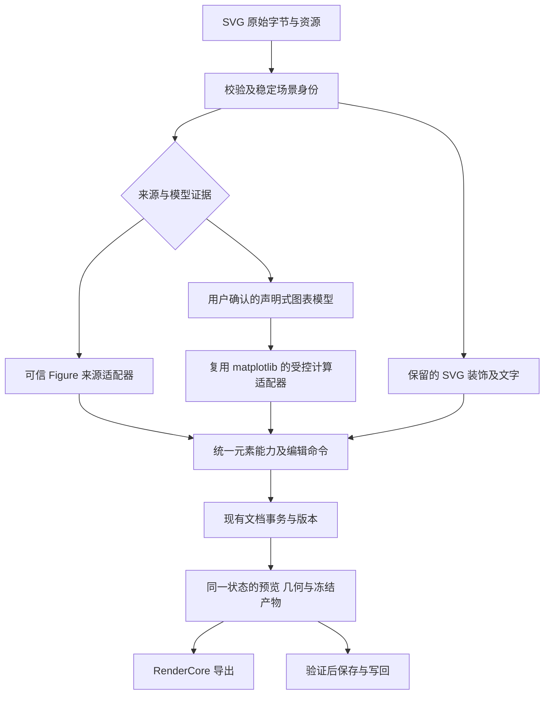

# SVG 计算图表编辑：分批实施与无人值守验证计划

> 状态：**2026-11-12 收敛修复轮已完成实施**（历史来源 P1、N5 显示框 F 六步、N4 声明式图例 C1–C5、测试红项修复），本地验证与文档同步进行/完成；PR 草稿可准备，仍未 push/建 PR。本文保留完整范围和最终产品验收口径；已实现/已验证/待完成状态见[PROGRESS.md](PROGRESS.md)，当前剩余外部项与接续提示词见[NEXT_PHASE.md](NEXT_PHASE.md)。不能由计划条目推断功能已完成或可发布。
> 初拟日期2026-11-03，当前计划及分支现场同步至2026-11-11（Asia/Shanghai）。当日fetch与后续点名远端heads查询核main仍为`2bc94f7fd9b13276f92d100fcd1b0e7075f49a93`；最新分支/产品提交、远端跟踪及未合入状态见NEXT_PHASE §1.1。恢复前重核实际HEAD/主线，不把本文快照视为永久最新。
> 当前唯一实施树`E:/0 - Project/Tavotto-svg-r00`，沿用分支`zixu.wang/svg-computational-r00`；原目录`E:/0 - Project/Tavotto`仍保留其main。用户后续明确要求不新建分支，恢复时以实际HEAD/diff为准，不切回初拟计划分支。
> 用户目标：以计算图表编辑为主扩展SVG输入，保留全部既有能力并交付实际可用产品；无人值守自主实现、修复、验证，在当前同一分支按不同功能分别commit。
> 实施已持续推进，最终M1/M2/M3仍未通过。无人值守指活跃会话持续迭代；未创建常驻调度器，也未部署、推送或合并，不以工作时长作为完成标准。
> 最新收尾（2026-11-09）：8129b8d6修内部 PDF 隐藏图层误显露，71ee8c78修写回验证/备份期间外部新原件被覆盖；准确退出码与局限见 PROGRESS。此前应用来源接纳和 PDF 内容适配保留已提交状态。前端候选仍未启用，真实问题是普通safe冷开被误当历史来源、显式运行采用及入口判据；此前native磁盘写回回归推断已被真实producer纠正，不扩不可达能力。PDF facade/有界child/HTTP未接，普通PDF→SVG未完成，当前不具完整功能发布资格。
> 用户明确恢复后：按NEXT_PHASE的PR00–PR07先核范围与大diff，再接同次执行证明/前端/冷恢复，并独立推进范围内几何与导出。通用普通PDF转换不是SVG输入的同义词，是否为本PR必做须按基线与公开承诺证明；既有功能不降级，原完整产品目标仍保留。最终check→replace残余问题继续跟踪，线上CI/维护者审查和发布资格分层记录。当前暂停不自动接续，不创建常驻调度。

## 1. 最终产品目标与完成口径

### 1.1 必须打通的三条用户路径

| 路径 | 用户输入与操作 | 最终结果 |
| --- | --- | --- |
| A：有可信绘图来源的 SVG | 导入 SVG → 验证其与既有 Python Figure/归档的绑定 → 修改坐标、图例、颜色等 | 复用现有 matplotlib 计算和编辑语义；保存、重开、导出一致；原本具备写回资格的来源仍可事务写回 |
| B：普通 SVG + 原始数据 | 导入外部 SVG → 选择轴、系列、数据列和单位 → 对照确认绑定 → 计算编辑 | 数值范围、刻度、数据位置、图例及颜色映射按绑定联动；未建模的注释和装饰保持原样；保存完整模型与来源 |
| C：已保存的计算 SVG/项目 | 导入本功能导出的 SVG 或打开项目包 → 校验模型和资源 → 继续编辑 | 在原 Python 不在场时，具备完整声明式模型的图仍可计算；仅有来源引用的图如实提示所需来源，不自动执行陌生代码 |

三条路径都计入最终验收。只支持 A、只显示普通 SVG、把全部元素转成路径后拖动、或把缺少语义的操作置灰，均不是本计划完成。

### 1.2 计算编辑与图元编辑的关系

- 修改坐标范围要改变数据到画面的位置映射；不能只改刻度文字。
- 修改系列样式要同步其图例；修改色阶范围要同步数据颜色与色条。
- 拖动标题、调整字号、移动图例等保留现有排版体验；这类操作不应更改科学数据。
- 图元级操作作为导入校正和装饰编辑的基础能力保留。系列点的拖动默认不改原始数值；若产品提供数据点编辑，必须有明确的数据编辑模式、事务及来源记录，不能偷偷移动曲线表示另一组数据。
- 轴、系列等语义对象的“进入组”和“取消视觉分组”不能隐式删除数据绑定。显式解除计算绑定是单独的、可撤销操作；原模型留在历史中。

### 1.3 信息边界与可完成范围

普通 SVG 不保证包含原始数值、单位、scale、误差定义、统计规则、被裁掉的数据或 3D 的 z 坐标。不能从可见图形唯一恢复这些信息。

本轮必须提供显式绑定入口，使用户补充缺失信息。自动识别/OCR/路径反算只能给候选，不能直接写成权威数据；未经确认的候选不进入计算重放和原文件写回。首版无需增加 AI/OCR 依赖，人工选择和列映射必须能完成流程。

对于外部 SVG，能重算的范围由实际绑定的数据和模型决定：有二维系列可改轴和样式；有网格及 norm 可改色图；有三维模型才能重新投影。用户不提供的信息不能由无人值守 Agent 编造。自动化测试使用预先定义、可独立核对的确认输入，不代真实用户确认其科学语义。

“所有现有功能”落实为逐项核对，而非口号：SG00 从当前功能登记表、manifest 能力及导出合同建立映射；既有 Python 功能必须全量保留，SVG 对等操作有明确的模型前提、实现批次和证据。缺少产品实现的格仍是未完成，不能伪装为“缺数据”。

### 1.4 交付层次

1. **已实现**：代码、迁移和用户入口完整；没有用假数据、mock 成功或隐藏失败替代。
2. **本机已验证**：针对本批 SHA 的行为、数值、几何和导出检查通过，写明环境与未覆盖项。
3. **交付资格通过**：支持矩阵要求的平台、打包、兼容与回归证据齐备。
4. **已发布**：另有发布授权并完成现行发行链。本文不授权推送、创建远程 Issue/PR、合并或发布。

整夜可以连续推进以上前三层的可执行工作，但缺少平台条件时不能把第二层改名为第三层。外部条件待补时保留明确 checkpoint，并继续不依赖该条件的任务。

## 2. 当前代码事实及改造落点

以下是基线源码审查结论，未在本次重新运行产品测试。路径相对仓库根。

| 现有实现 | 当前事实 | 本轮工作 |
| --- | --- | --- |
| `src/tavotto/svgasset.py`、`src/tavotto/app.py` 的 SVG 素材服务 | 有受限静态 SVG 读取、尺寸解析及展示；不是独立计算编辑器 | 复用读取边界，接入模型和编辑入口；原静态预览继续可用 |
| `web/src/types/document.ts` | `PanelFileKind` 已有 `svg`；已有 overrides、面板变换和 Figure 快照 | 扩展来源描述/模型引用与迁移；不重复增加文件类型、不建第二个顶层文档 |
| `engine/manifest.py`、`overrides.py`、`patchspec.py`、`pathgeom.py` | 当前能力、属性应用和几何围绕 matplotlib 对象 | 优先复用其计算能力；为 SVG 场景与稳定模型身份增加适配 |
| `engine/enginesession.py`、`figsession.py`、`wireproto.py` | safe/native 来源路由与 Figure 编辑已统一 | 保留两种执行入口；静态来源与声明式模型不能被误判成用户 Python 脚本 |
| `engine/exportroute.py`、`rendercore/sources.py` | runtime/overrides/rerender 与执行来源有关联；静态 SVG 合成有限制 | 把“谁产生这个版本”作为统一来源判据，不能继续用“有 override 就要 Python”覆盖 SVG |
| `engine/svgstore.py`、`svgexecution.py`、`FigureSnapshot` | 保存的是带执行回执的 Figure 产物和身份 | 不能给独立 SVG 伪造 Figure 回执；使用显式来源类型及验证过的版本引用 |
| `rendercore/ir.py`、`svgwriter.py`、`pdfwriter.py` | 已有 SVG 输出与同源 Figure 配对；`FILE_KINDS` 尚无原生 SVG 输入 | 扩展来源/合成合同；不只是把 `svg` 塞进枚举就宣称支持 |
| `rendercore/svgcheck.py` | 单一静态 SVG 校验边界；拒绝不安全内容，非静默清洗器 | 统一服务导入、内嵌预览、导出再导入和元数据解析 |
| `documentStore`、`renderStore`、`svgPreviewStore` | 文档事务、渲染版本、临时预览已有清晰边界 | 继续共用；任何 SVG 交互不得绕过 commit/事务、几何权威和项目代际 |
| `app.py` 的原图标注导出、RenderCore 画布合成 | 原图与整页是不同导出范围，已有标注叠加路径 | SVG 适配必须同时覆盖，不能只做单图文件下载 |
| `docs/features/registry.json` | 已有静态 SVG 素材预览和 SVG 导出登记 | 保留既有条目，新计算入口随真浏览器 e2e 登记 |

本轮不重写已经稳定的 Python 执行、环境发现、native 屏障、图幅定义、版本时间线或认证模块。

## 3. 架构方向与前置实验

### 3.1 首选方向



推荐先验证“**保留 SVG 场景 + 显式语义绑定 + 复用现有计算内核**”：未绑定区域由原场景保存；绑定区域按图表模型重算；每个区域只有一个权威产生者，合成时替换对应区域，不叠画两遍。区域中的 clipping、paint order、字体及与装饰的交叠需有明确契约。

这是一条待实验验证的结构性候选，并非已经证明保真。SG01 必须用反例比较：

| 候选 | 需证明的优点 | 主要反例 |
| --- | --- | --- |
| 声明式模型全部生成 matplotlib Figure | 最大限度复用现有编辑及导出 | 外部复杂 SVG 的文字、布局和装饰被重绘而漂移 |
| SVG 场景保留，绑定区域使用现有计算内核 | 保留外观，同时让科学关系可计算 | 区域边界、透明组、叠放顺序、坐标与字体不一致 |
| 原生 SVG 场景直接承担全部科学计算 | 可直接改源结构 | 重新实现 tick/scale/norm/legend 形成第二份科学规则，与现有功能长期分叉 |

首选第二条；如果核心实验否定它，先修模型/合成结构并重试，再根据证据更新本计划及 ADR。不能未经实验改成全图栅格化、自动重画成近似图或永久关闭某类操作。

### 3.2 持久状态与派生状态

下列名称表示拟议职责，实际模块命名在 SG02 冻结，不表示仓库已有这些类型。

- **SourceDescriptor**：来源种类、原始字节摘要、文档/项目归属、版本、资源清单；Figure 与声明式 SVG 的身份不可混用。
- **SvgScene**：保留原始文字、分组、路径、样式和资源引用；稳定节点 ID；不把浏览器 DOM 对象写进项目。
- **ChartModel**：轴及尺度/单位、系列、数据引用、色阶、图例关联、注释的 data/axes/figure 锚定、布局约束；仅声明式数据，不含任意 Python/JS、pickle、可执行 formatter 或命令。
- **Binding**：源节点/区域与模型对象的映射、确认依据及修订号；源或数据改变后重新验证，失败不能按旧位置套给新对象。
- **Edit state**：复用现有事务和 override writer，必要时增加类型化命令及确定的应用顺序；模型变化和视觉覆盖之间有明确优先级。
- **Render result**：同一版本的 SVG、manifest、几何和预览；缓存键包含所有实际影响输出的版本/配置摘要，不能只靠文件名。
- **Frozen artifact**：导出/保存引用的不可变版本，包含来源与模型/patch/字体资源的绑定，以及影响重算的计算引擎、matplotlib/转换器版本和 rc 配置身份；不把热预览缓存当作导出原件。

文档是一份，模型和 SVG 资源可以作为它引用的不可变附件保存；不是第二个编辑应用或第二套用户历史。几何、测量结果和低清预览是派生数据，不作为持久语义真值。

### 3.3 必须沿用的边界

- 会话认证、项目路径约束、MCP 写目录权限和执行授权沿用现有链。
- 导入 SVG/元数据不运行用户脚本；本地 hash 只证明一致性，不证明第三方元数据可信。数据模型也要做 schema、范围、资源预算和引用验证。
- SVG 库/native 依赖按现行进程边界进入适配层，Flask 父进程不能因此 import matplotlib；不得把用户环境改造成内置 runtime。
- PDF 仍经 `pdfbackend/` 契约及 RenderCore；发行闭包继续零 PyMuPDF。
- 运行时缓存、临时件和自动保存使用 `engine/config.data_dir()` 体系；用户主动保存/导出的目标与现有项目包规则保持一致，不能向安装目录写数据。
- SVG 原件、数据附件和模型的多文件保存必须有单一可恢复提交点；逐个 `replace` 不等于多文件原子事务。
- 来源绑定与画布外观调整必须可撤销；编辑、导出、冷启动和写回使用同一语义。

## 4. Git、工作区和提交规则

### 4.1 开始实施前

> 2026-11-06按用户后续要求更新：**只使用已有实施树和当前分支，不新建/切换分支或worktree**。此条取代最初计划中的新建实施分支及代理独立worktree要求。当前执行状态与顺序见PROGRESS/NEXT_PHASE。

1. 重新读取最新根/子目录规则和 `docs/rules/repo/lessons.md` 对应节；记录原工作区状态、当前分支、git 用户名/邮箱。
2. 核对当前HEAD、远端引用及已取得的远端证据；集成前按需要 `git fetch origin`，记录时间和SHA。失败或本轮未fetch时不能把缓存引用称为最新，不因只读远端失败丢弃本地已验证成果。
3. 沿用 `E:/0 - Project/Tavotto-svg-r00` 的 `zixu.wang/svg-computational-r00`。原目录 `E:/0 - Project/Tavotto` 保持原有main内容，不自动合并、拷回或改分支。已提交成果与未完成差异均须保留；后续实际HEAD可能前进，不能回退到文档快照。
4. 用户未提交修改留在原工作区，不自动 stash、不 reset、不覆盖。设置绝对 `PYTHONPATH=<实施 worktree>/src` 并探测实际 import 位置，确认测试运行的是该树。
5. 同一分支按功能顺序commit。已授权的独立代理共用实施树，一个文件同时一个写入者；根代理统一契约、app集成及提交。不为并行任务另建分支/worktree。

只读启动核对（在现有实施树执行，每条检查退出码；不含新建/切换命令）：

```powershell
git status --short
git config user.name
git config user.email
git branch --show-current
git rev-parse HEAD
git diff --stat
git diff --cached --stat
git rev-parse origin/main
```

### 4.2 按功能 commit

- 每批表中的 commit 是功能边界，复杂批次可拆为多个完整功能提交；不能把 SG02–SG16 压成一个“支持 SVG”提交。
- 同一契约的后端、前端镜像、行为测试、必要迁移与文档必须同提交，不能为了分层让中间状态破坏协议。
- 仅暂存本批具体路径，检查 staged diff；不使用无审查的 `git add .`，不加 `Co-Authored-By` 尾注。
- 只提交达到本批验收的功能；未完代码留在当前实施树，在checkpoint标明dirty/未验证，通过定向暂存隔离；不另建worktree，不写passed掩盖失败。
- 修复在对应功能后单独 `fix(...)`；连续修复暴露同一结构问题时执行第三路径审查，不堆例外。
- 新核心不变式先保存精确快照，优先使用进程内变异或仓库外独立实验反证；确需临时修改生产文件时，冻结其他写入者与watcher，验证后逐字还原并核SHA，不覆盖其他改动。功能提交前取得真实失败证据，不为反证新建分支/worktree。
- 集成验收前核对主干变化及相关接口，不为每个commit自动rebase或合并。确需同步时先保留当前差异，评估双方改动，按现有授权处理，重跑受影响检查；不能静默换基线后沿用旧SHA资格。
- 完整验证期间冻结工作树，不同时编辑、重建产物、rebase 或执行变异。同步基线后原测试证据不能自动转移到新 SHA。
- 每批开始记录上一个已验收 commit 作为回退点；功能问题优先修复，需撤销已提交功能时在自己的干净分支用可审查的 revert，先保留未提交工作；禁止 `reset --hard` 或清理原用户目录。数据迁移/写回必须有独立恢复验证，代码回退不等于用户数据可回退。
- 本轮只进行本地提交。以后获得推送授权时用显式 `git push origin HEAD:<分支>`；不自动强推主干、不改变远端默认分支、不自动合并或发布。

### 4.3 分支与 PR 不混为一谈

“按功能分别 commit”不要求自动创建多份 PR。默认先在本地实施分支保留可审查提交序列；如后续要求拆 PR，再按已验证依赖拆栈。

仓库 PR workflow 仅对 base 为 main 运行，叠栈 PR 不能用没有运行的 CI 冒充通过。向最新 main retarget 后按仓库规则同步并重新验证。ADR 编号在真实实施时核对冲突，本文不预占号码。

## 5. 分批总表

状态初始均为 `pending`。每批以验收证据推进，编号不代表固定耗时；任务量不能保证一夜完成。

| 批次 | 交付 | 依赖 | 主功能 commit 建议 |
| --- | --- | --- | --- |
| SG00 | 最新基线、能力清单、回归基线与语料 | 无 | `test(svg): establish computational editing baseline` |
| SG01 | 计算与保真架构实验、ADR 和范围登记 | SG00 | `docs(svg): record validated computational editing architecture` |
| SG02 | 来源、模型、绑定及身份契约 | SG01 | `feat(svg): add versioned chart source and binding contracts` |
| SG03 | 安全导入与资源管理 | SG02 | `feat(svg): admit bounded static chart sources` |
| SG04 | 可信 Figure 来源采用与语义导出元数据 | SG02、SG03 | `feat(svg): bind imported charts to verified figure sources` |
| SG05 | 稳定场景、坐标、文字和分组适配 | SG03 | `feat(svg): preserve scene identity and element geometry` |
| SG06 | 普通 SVG 的数据/轴/系列绑定流程 | SG02、SG05 | `feat(svg): add explicit chart data and axis binding` |
| SG07 | 轴、二维线/散点、刻度的计算闭环 | SG01、SG06 | `feat(svg): recompute axes and xy series from bound data` |
| SG08 | 柱图、误差、统计图及图例联动 | SG07 | `feat(svg): preserve series and legend computation semantics` |
| SG09 | 色阶、图像/网格、复杂投影与能力对等 | SG07、SG08 | `feat(svg): complete chart family and color scale adapters` |
| SG10 | 现有画布与属性面板全面接入 | SG04–SG09 | `feat(svg): integrate computational charts with editor actions` |
| SG11 | 保存、版本、恢复、项目包及迁移 | SG02、SG10 | `feat(svg): persist and restore complete computational charts` |
| SG12 | 五格式、原图/画布/标注导出 | SG04、SG09–SG11 | `feat(svg): export frozen computational chart versions` |
| SG13 | 原件写回事务与冲突恢复 | SG11、SG12 | `feat(svg): verify chart writeback before atomic commit` |
| SG14 | 预检、样式、出版规范、状态与错误 | SG09–SG13 | `feat(svg): integrate chart capabilities with publication checks` |
| SG15 | 桌面、CLI、MCP、playground 与发行依赖 | SG10–SG14 | `feat(svg): expose computational editing across supported entries` |
| SG16 | 全链路回归、性能与独立反例修复 | SG00–SG15 | 按缺陷分别 `fix(svg): ...`；验证编排 `test(svg): qualify computational editing workflows` |
| SG17 | 支持平台真产物验收、交付说明及复核 | SG16 | `docs(svg): record delivery evidence and remaining platform checks` |

核心路径：SG00 → SG01 → SG02 → SG03 → SG05 → SG06 → SG07–SG09 → SG10 → SG11 → SG12 → SG13 → SG14 → SG15 → SG16 → SG17。

SG04 可与 SG05 的独立部分并行；SG11 的存储原型、SG12 的渲染候选实验、SG15 的入口盘点可提前进行，但不能提前宣布对应批次完成。默认每次只让一个代理拥有某个共享契约文件。

早期批次的核心测试使用独立输入/输出及最小交互，不依赖未来的完整产品接线。SG05/06 的磁盘保存重开、SG08 的项目恢复等全链验证在 SG11/12/16 追验并记录，不能把该追验反过来当作其前置批次的退出门槛。

## 6. 每批任务与退出条件

### SG00：基线与“全部现有功能”清单

- [ ] 从新 worktree 记录 HEAD、工具链、解释器实际 import 路径、字体/依赖条件、支持矩阵及未提交改动。
- [ ] 把 `docs/features/registry.json` 中每个 active 功能映射为：原路径回归证据、SVG 对应操作、数据/语义前提、负责批次。补充 registry 之外的 manifest 可编辑属性、原图/画布导出合同、safe/native、runtime 和冷态行为。
- [ ] 特别纳入最新的面板边/角缩放、文字旋转、时间线 scrubber、期刊选择、原图标注导出，不能沿用旧主干清单。
- [ ] 建立带独立原始数据与图表含义的 SVG 语料：可控 matplotlib SVG、外部工具导出、纯图元、文字转曲、`use`、嵌套变换、裁剪/透明组、渐变和嵌入图片。第三方样本记录许可/上游版本/hash，不把用户私有图或数据提交。
- [ ] 使用既有检查入口测量基线，区分产品失败和环境缺失，保存结果 SHA；先确认现有 Python 路径可跑。

退出：能力清单无未归属项；至少有 A/B/C 三条验收配方及可复现数据。基线红不能自动归为本次缺陷，也不能忽略后续新红。

### SG01：前置实验与架构决定

- [ ] 比较第 3 节候选，原型放独立实验目录/分支，不先大改核心；用同一组文字、几何、透明和数据样本评估。
- [ ] 实验一：零编辑导入 → 渲染 → 保存重开，测视觉/字体/几何；实验二：改线性和 log 轴范围，独立验证点坐标及刻度；实验三：保留装饰的区域替换 → PDF/SVG 导出。
- [ ] 实验四：脱离开发机器/用户 Python 的冷恢复；实验五：同一文件两实例不同编辑；实验六：恶意元数据不得触发脚本或外部读取。
- [ ] 独立审查者专找无法兑现的反例，尤其是透明组跨越绑定区、文字转曲、共享 axis、多系列和双轴。
- [ ] 决定计算适配、SVG 解析/渲染依赖、PDF 与 EPS 路径；为每个支持平台确认可构建/分发条件。
- [ ] 写 ADR，并在现有 1.0 收敛文档登记用户已明确要求的本项扩展及边界；不借此授权无关重构。涉及第三路径的结论按实际证据填写。

退出：核心三条路径有可运行的最小证据；不以架构图代替实验。若没有满足原图保真与计算正确性的方案，依赖本决定的批次不得推进为产品实现，可继续语料与独立测试准备。远端根因 Issue 在获得相应操作授权后补建；未有编号不得伪填或关闭根问题。

### SG02：模型和身份契约

- [ ] 冻结来源判别、schema 版本、ChartModel、数据修订、Binding、能力及稳定错误码；前后端同源镜像同提交。
- [ ] 为声明式模型定义单位、缺失值、NaN/Infinity 处理、日期/分类编码、数组形状、axis/series 引用、资源预算及不支持版本行为。
- [ ] 来源、数据、模型、patch、字体资源和渲染代之间有显式版本关系；数据改变不会复用旧几何/旧快照。
- [ ] 固定计算环境身份：引擎/依赖/转换器版本及影响输出的 rc 配置进入重放合同；相同模型在不同环境不能直接声称同一计算版本。
- [ ] 定义绑定区域与原场景的唯一所有者、覆盖应用顺序，以及 rebind 后旧 edit 的保留/冲突/迁移规则。
- [ ] 保留旧项目读取；需要 schema 升版时给出迁移与旧版防损策略。不能默认旧程序忽略新字段后仍能安全保存新项目。

退出：合法模型往返一致，错误版本/错源/改数据/重复 ID 可被真实消费方拒绝；移除身份校验的反证会失败。不得在 metadata 中放可执行代码或完整机器路径。

### SG03：安全 SVG 导入

- [ ] 复用 `svgasset`/`svgcheck` 解析、物理尺寸、viewBox 和预算，明确新增安全静态结构的处理。
- [ ] 统一文件选择/项目扫描/服务端/MCP 实际接入；重复引用资源的校验一致，导入只读不执行。
- [ ] 检查 DTD/实体、脚本、事件、外链、CSS URL、嵌套 SVG/data URI、循环 use、深层分组、图片解码预算、巨型路径和取消超时；SVGZ 若未实现不自动解压接受。
- [ ] 对已经接受的源保持原始字节与资源基准；遇不支持结构给出具体元素/恢复路径，不能删掉后继续称原图完整。
- [ ] 现有静态 SVG 预览、非 SVG 素材和项目认证不回归；内联编辑的攻击面不能因原 `` 展示安全而被省略。

退出：无外部网络/任意路径读取或脚本执行；合法样本不缺元素；失败原件不变，预算超限可取消且进程可回收。

### SG04：可信来源采用与元数据往返

- [ ] 从现有受验证 Figure 版本、执行回执或显式绑定取得来源，禁止按相邻同名 `.py` 猜测。
- [ ] 对来源绑定复用 safe/native/run config 授权与环境选择；静态导入和冷快照读取不自动运行用户代码。
- [ ] 设计纯数据元数据：模型/数据是否完整、外部引用、版本/hash/资源表；“只含引用”和“自包含模型”在产品中含义不同。
- [ ] 将可序列化的明确能力导出为声明式模型；自定义 Python transform/formatter 等不能伪装成可移植模型，可保留来源依赖并写清能力前提。
- [ ] 从元数据重新建立绑定仍需验证资源和模型；第三方复制/篡改元数据不能获得旧回执授权。
- [ ] 重放元数据里的模型并与 SVG 可见内容核对几何/视觉；外部软件改图而保留 metadata 时，不把 schema/hash 合法视为模型等价。存在差异进入 SG06 的对照确认流程，不能首次重算时静默换图。
- [ ] 将可移植计算数据与纯外观输出分开：自包含模型可能包含未显示点、完整统计样本等，携带范围必须可列举；具体导出选择与隐私验收在 SG12 落地。

退出：同名错源、改源、过期快照、伪造 owner、native 离线均不会进入错误 Figure；已有 SVG/PDF 配对导出与冷恢复不回归。

### SG05：场景、坐标与文字几何

- [ ] 解析源场景并保留节点身份、分组、样式继承、defs/use/clip/mask/gradient 等已接受结构；区分定义与实例。
- [ ] 建立 SVG 用户坐标 → 物理 pt → 面板裁剪/翻转/旋转 → 页面 mm → 屏幕的统一变换链，包含非零 viewBox 和 preserveAspectRatio。
- [ ] 几何由实际渲染事实产生，命中、绘制顺序、透明度、线宽、文字基线和变换一致；不拿旧 manifest 做新写入。
- [ ] 取消组合保留累计变换、样式和透明组语义；复制时重映射 ID 与资源引用；编辑一个 use 实例不误改其他实例。
- [ ] `<text>`/`tspan` 接入现有文字词汇与适配器，转曲文字仍为路径，不能冒充可改字符。保留或替换字体必须可说明并进入验证。

退出：核心 harness 中拖动/缩放/撤销及场景序列化重载位置一致；组透明重叠、非均匀变换、跨实例引用和中文文本反例通过。真实项目重开在 SG11/16 追验；只显示 bbox 不算精确选择完成。

### SG06：普通 SVG 的显式建模流程

- [ ] 提供“建立计算关系”流程：选绘图区和轴 → 选 scale/单位 → 导入或粘贴数据 → 选系列及列 → 预览差异 → 确认。
- [ ] 数据入口至少覆盖有类型检查的 CSV/表格粘贴及模型内数组；列名/小数/日期/缺失值错误能定位，不静默填零。
- [ ] 坐标校准包含线性、log 和倒轴的证据；类别轴不能强行套连续线性映射。多轴/多面板先明确归属。
- [ ] 候选识别只辅助选择；转曲标签允许用户补文本，隐藏/裁剪数据要求原始数据，不靠路径猜全量样本。
- [ ] 注释/箭头明确是固定页面位置、轴内相对位置还是数据锚定；已绑定数据锚点进入模型，未知关系在确认预览中提示，不能把所有注释一律当作固定装饰。
- [ ] 在确认前展示数据映射、几何偏差、缺失对象、拟保留装饰及模型替换范围；确认/取消/重绑均可撤销。
- [ ] 一个普通 SVG 样本不依赖 Python 来源或云服务即可完成绑定；取消后原件与文档回到原状态。

退出：真浏览器操作完成 B 路径的“导入→选择数据/轴/系列→对照→确认或取消”，产出可核对的 Binding/ChartModel；错选轴、列、单位、负值 log、未确认候选不能产生伪成功。计算验收在 SG07，真实保存/导出在 SG11/12，B 全链在 SG16；无人值守使用明确 fixture 操作，不代真实用户决定数据含义。

### SG07：最小计算闭环

- [ ] 用绑定数据实现二维线与散点，轴范围、线性/log/倒轴、主次刻度、标签格式、轴标题、spines 和网格按现有可用能力接入。
- [ ] 复用现有 locator/formatter、scale 和 override 机制，禁止另写一套近似 matplotlib tick 规则。
- [ ] 图幅/绘图区几何与样式调整不污染原始数据，标题偏移与用户布局在重算后保留。
- [ ] 数据锚定注释随轴范围/尺度/数据更新移动，仍指向同一数据对象；axes/figure 锚定保持各自单位和位置语义。锚点数据被删时显式报告，不自动挂到另一个点。
- [ ] 处理 NaN 间断、裁剪、重复 x、非单调系列、空系列、多个数据列和数据替换。
- [ ] 确定模型编辑→生成 Figure/场景→manifest→预览的版本提交顺序；旧响应不能覆盖新数据。

退出：改范围后独立坐标公式能验证数据点位置，刻度与标签一致；数据替换引发曲线改变；撤销恢复数值与外观；热态与冷重放一致。这是里程碑 M1，不是整个功能完成。

### SG08：系列族、统计关系和图例

- [ ] 按 SG00 能力矩阵接入柱图、横向/分组/堆叠柱、误差线、面积、箱线/小提琴等现有可编辑系列族。
- [ ] 区分原始样本、预先汇总统计和仅有绘图几何；没有分布样本不能声称重新计算统计量。
- [ ] 误差定义、上下界、分组顺序及单位保存为模型事实；更新数据时正确重算有关图元。
- [ ] 图例 entry 与系列用稳定语义 ID 绑定，系列颜色/marker/线宽与图例同步；排序、隐藏、复制与撤销不串系列。

退出：每个现有对应族有数值、用户操作及新计算会话重放证据，真实项目恢复在 SG11/16 追验。SG00 中的族不能静默删掉；尚缺实现则该批未完成，待补数据与待补产品实现分别记录。

### SG09：色阶、复杂图及能力对等

- [ ] 绑定标量数组/网格、norm、cmap 和色条，复用既有同组 cmap 规则；调整 vmin/vmax/log norm 后图元与色条同步。
- [ ] 图像、集合、contour 等按真实数据形状建模；只含嵌入位图的 SVG 不能自动获得原始标量阵列。
- [ ] 对现有极坐标、共享/双轴、inset、3D 等能力逐项盘点：来源绑定路径维持原行为；独立模型在具备相应输入时实现对等适配并验证。
- [ ] 3D 需真实三维坐标及投影参数；改变视角后命中几何、深度绘制次序、逐点样式和隐藏恢复一致。
- [ ] 完成 SG00 属性逐项核对；真实自定义 Python 行为继续通过原来源运行，不能假称声明式通用模型已实现任意 Python。

退出：色条/数据联动反例和复杂族重放通过；所有计划内对等项均有实现或信息前提证据，单纯置灰不关闭任务。

### SG10：编辑器集成

- [ ] 元素树、Inspector、直接文字编辑、拖动、框选、多选变换、对齐分布、复制粘贴、锁定/隐藏、z 序、分组接同一命令与文档事务。
- [ ] 接入现有 TypographyAdapter、快捷键/菜单、gestureCoordinator 与离散动作闸门；一次手势一次撤销，输入框不抢全局快捷键。
- [ ] 复用 exactPanelRender、renderKeyOf、项目代际及响应序号；预览平面只改临时 DOM，不保存、不发后端历史。
- [ ] 保持最新版图幅语义：边缩放的留白/裁剪与角缩放的图幅变化分别验证；文字 pt、面板 crop/flip/rotation 不漂。
- [ ] Python/SVG/PDF/raster/runtime 混合画布，复制实例独立编辑，跨项目切换和重绑时不互相污染。

退出：真实用户手势与键盘路径验证通过；旧 Python 图完全走原有语义；SVG 编辑不存在第二套 documentStore 或独立 undo 栈。

### SG11：持久化、版本与恢复

- [ ] 把模型、数据快照、绑定及 SVG 资源引用纳入现有保存、自动保存、另存为、版本时间线和项目包。
- [ ] 采用不可变附件/内容地址及明确提交点，按已有版本保留策略管理资源；不能因缓存淘汰导致命名版本不可恢复。
- [ ] 保存引用锁定用户当时看到的版本；数据文件外部变化提示新版本，不在重开时自动替换旧数据。
- [ ] 覆盖中断、磁盘满、权限失败、损坏附件、版本不支持、文件移位、中文空格路径及跨机器离线恢复。
- [ ] 老项目无新字段时行为不变；迁移可重入，旧原件保留；旧程序无法安全修改新语义时采用明确兼容策略防止静默丢失。
- [ ] 引擎升级或跨机器计算环境不匹配时，已保存冻结产物仍能按其版本读取；第一次用新环境重算先迁移/验证，必要时对照确认，不静默把不同刻度/布局当成原版本。

退出：关进程再打开、版本回退再撤销、包移到另一目录/环境都重现同一图；保存半途失败没有半份模型被采纳。

### SG12：导出闭环

- [ ] 扩展 exportroute、SourceResolver、FrozenSource、IR 和适配层，使 SVG 计算来源与 Figure 来源均按同一冻结版本导出。
- [ ] 覆盖 original/canvas 两种范围、原图标注叠加、多页面/多面板实际现有行为；PDF/PNG/TIFF/SVG/EPS 五格式逐项核对。
- [ ] SVG 保留可编辑文字策略和资源 ID/CSS 隔离；导出模型元数据为可选可移植数据，纯外观 SVG 另有明确结果说明。
- [ ] 默认纯外观分享不夹带原始数组、被裁掉/隐藏的数据、本地路径和计算模型；“携带计算数据”由用户显式选择并展示携带清单。自包含 SVG 不宣称能在隐藏数据的同时完整重算；验证两种输出内容及再导入行为。
- [ ] PDF 保留可兑现的矢量/文字；PNG/TIFF 按现有栅格化与 PPI 规则；EPS 对透明、滤镜和复杂场景的表达能力需在 SG01 证实并给逐元素/逐格式结果。
- [ ] 不能宣称 EPS 或任何目标格式可无损表达所有 SVG；所需视觉效果无法保持时报告该格式失败，其他格式按现有 partial 规则交付，不能静默栅格化并标成纯矢量。
- [ ] 导出不重跑不应执行的用户脚本，不使用旧预览冒充成品；取消、覆盖冲突、临时件清理和原子发布沿用现有作业服务。

退出：五格式及两范围均有成功样本和应失败样本；独立读取器核尺寸、文字、矢量/位图组成和关键像素；缺一面板/错一版本必红。能力披露不能替代应该支持的常规样本实现。

### SG13：安全写回

- [ ] 保留现有 Python/原图写回资格；native、runtime 等原来没有原件写回资格的情况不能因为 SVG 入口而绕过。
- [ ] SVG 写回按 prepare → verify → commit：冻结原件与模型、全量冷重放、几何和像素比较、校验外部修订、备份后原子提交。
- [ ] 多附件使用单一提交点/可恢复日志；并发修改或验证失败返回稳定冲突结果，原 SVG 和相关原数据零改动。
- [ ] 保存项目、导出新文件、覆盖 SVG、改源数据、改 Python 源码是不同操作；不得让一次图形编辑隐式覆盖原始实验数据。
- [ ] 使用仓库已有写回/脚本修改确认合同；测试只覆盖专用 fixture，开发授权不等于允许无人值守覆盖用户真实项目。

退出：权限/磁盘/中断/外部改动/像素不一致的故障注入均保住原件；成功时热态、文件、冷重开一致；削掉 verify 的反证必失败。

### SG14：预检、样式与状态

- [ ] 复用 publication.json、preflight、validationStore、定位与修复链；只有一份问题判据。
- [ ] 字号、线宽、页面尺寸、颜色及有效 DPI 按原图/页面坐标正确计算；转曲文字不能伪报字体检查已通过。
- [ ] 原始值/当前 override/继承值可区分，应用和撤销用户样式不覆盖数据绑定；支持期刊与规范快照。
- [ ] 来源准备、未绑定、绑定冲突、数据变化、资源缺失、可恢复动作由后端给事实，前端不从有无 script 猜可编辑性。
- [ ] 中文/英文文案、错误码闭集与能力镜像同步；状态日志和诊断包遵守脱敏，不新增用户数据遥测。

退出：问题面板、导出提示和编辑能力不互相矛盾；点击问题能定位当前版本元素，自动修复可撤销且不改变科学数据。

### SG15：入口、插件和发行依赖

- [ ] 桌面选择器、拖放、CLI/handoff、最近项目/素材扫描识别 SVG；沿用现有 `.py/.R/.r/.m/目录` 优先级契约，并扩展同源黄金向量，不破坏已有来源选择。
- [ ] MCP 与内嵌画布通过相同认证/项目/能力接口；不新增 native 执行权限，不用工具侧自写第二套 SVG 编辑规则。
- [ ] playground 核对模型/库的浏览器可用性，所需产物按现行脚本生成；不能静默让网站 demo 与桌面含义不同。
- [ ] 若引入 resvg 等依赖，落实 Python wheel/sidecar/wasm 的实际形态、版本锁、字体、许可证、平台架构和离线运行；不能假设用户已安装系统工具。
- [ ] 新能力逐项登记 feature registry 和真浏览器 e2e；保留所有现有 active 功能项。
- [ ] 核对 `web/playwright.config.ts` 的 `webkit`、`chromium-en` 显式 testMatch，将关键 SVG spec 纳入实际集合，用 `--list` 对拍后运行；不能因中文 Chromium 绿而宣称英文/WebKit 已测。
- [ ] 仅同步受影响的使用说明、技能/插件文案、架构/规则索引和发行说明；运行时仍不写安装目录。

退出：桌面、CLI、MCP 的适用路径可实际进入并完成编辑保存；wheel/桌面包包含真实依赖且可离线运行；未知宿主不擅自升级支持口径。

### SG16：集成回归与性能

- [ ] 冻结最终候选树，完成第 7 节验证矩阵及完整现有套件；SG00 基线中原路径无新增失败。
- [ ] 运行四路等价性、核心不变式、随机操作序列、SVG 自身语义序列及 CompatBench；各自回答的问题不能相互替代。
- [ ] 对新增核心判据做反证：错轴、错版本、删 verify、漏系列、错字体、错误颜色联动应分别让对应检查失败。
- [ ] 比较同机性能/内存：小图交互、10k/100k 节点样本、重复实例、大数据、长历史、取消和恢复；阈值先依据现有性能基线和 SG00 测量确定，不在失败后放宽。
- [ ] vector/hybrid/raster 预览可沿用现有复杂度策略，编辑能力和高质量导出不缩水；CSS/DOM 交互性能与后端渲染性能分别量。
- [ ] 独立评审数据丢失、热/冷/导出不一致、平台差异及现有功能回归；每个发现以具体触发场景→错误结果记录，修复后定向复验。

退出：必需格通过，无新增丢编辑/错图/认证绕过/门禁空转。排除试验失败与旧基线失败需要证据，不能通过更改 baseline/skip/容差凑绿。

### SG17：平台资格与最终交付

- [ ] 按当前 `docs/support-matrix.json` 验 Windows 与 macOS 两架构真产物，Linux 依当前 beta/browser 口径，不能从一台 Windows 的通过推出全平台支持。
- [ ] 新装、无用户 Python、中文空格目录、离线冷启动、保存重开、升级旧项目、混合画布导出及进程清理都覆盖。
- [ ] 真壳能力按现行 Windows nightly 和 macOS 人工/可用工具边界记录；浏览器 e2e 不冒充 WebView 真窗口，IME 等人工格未测就保留未测。
- [ ] 复核 SG00 能力清单每一项、所有批次、commit、测试 SHA 和平台证据；回滚方案验证能回到旧产品并保住用户原文件。
- [ ] 文档写清已实现/已验证/待平台验收/待发布；给出使用步骤、计算绑定前提、格式限制和恢复办法。

退出：A/B/C 路径与全部适用功能有完整证据，必要平台检查无缺口，用户可拿到可运行产物。没有发布授权时交付本地成果及证据，不发布。

## 7. 验证矩阵与执行入口

### 7.1 验证对象先于断言

每条测试写清：哪种来源、哪个进程、哪个文档版本、哪个时间点、哪个坐标空间，以及通过究竟证明什么。数据正确性、几何正确性、像素一致性分别取证。

| 层 | 必测内容 | 证据/既有入口 |
| --- | --- | --- |
| 纯契约 | schema、类型、单位、身份、资源图、迁移 | 新增针对性测试；前后端 golden vectors 只保存真正跨语言合同 |
| 计算正确性 | 数据→坐标，刻度/系列/图例/色阶关系 | 已知数据及独立公式/原生 matplotlib 对照，不能拿同一实现对拍自己 |
| 编辑事务 | 撤销/重做、rebind、并发响应、项目切换 | `documentStore`/渲染调度行为测试及真浏览器 e2e |
| 渲染保真 | 导入零编辑、绑定后确认、字体、clip/use/透明组 | 固定字体与尺寸的差异图、独立读取器、关键结构断言 |
| 来源/快照 | 字节变化、执行代、冷快照、错误 owner | 既有 `test_svgstore.py`、`test_svg_execution_lifecycle.py` 等加针对性用例 |
| 冷热等价 | 热编辑、清空重放、新会话重放、写回后重放 | `tests/test_equivalence_matrix.py`、`tests/test_invariants_engine.py` 及 SVG 对应腿 |
| 导出 | 五格式、两范围、标注、文字、混合面板、partial | `tests/test_export_svg.py`、`test_rendercore_svgwriter.py`、新计算来源用例 |
| 数据安全 | 未授权路径/脚本、预算、资源、写回失败 | 实际产品边界测试与故障注入，不以文本搜索代替 |
| 原功能回归 | SG00 全量映射，safe/native/runtime、老项目 | 既有后端/前端/CompatBench/E2E，不移除登记条目 |
| 发行 | 可安装、离线、运行时、平台字体和进程树 | package smoke、desktop/nightly 和支持矩阵对应证据 |

### 7.2 现有命令与顺序

以下在实施 worktree 根运行；`<python>` 代表属于该验证环境的绝对解释器路径，Windows 常见 `.venv/Scripts/python.exe`，POSIX 为 `.venv/bin/python`。使用前检查存在，不把本计划中的未来测试文件当作已经创建。

1. 环境与字体：`<python> scripts/fetch_fonts.py`；固定 `TAVOTTO_NO_TELEMETRY=1`，隔离 DATA/CONFIG/MPLCONFIG 等测试目录，设置绝对 PYTHONPATH 并打印包实际路径。
2. Python 改动：先对本批文件 Ruff 修正和复查，再 `ruff check .`、`ruff format --check .`，再 `<python> -m pytest <实际存在的针对性测试>`。不对用户改动和示例语料做无关批量格式化。
3. 前端改动：在 `web` 中 `pnpm lint`、`pnpm test`、`pnpm build`，涉及文案再 `pnpm i18n:check`；类型检查不是 `tsc --noEmit`。当前 test script 使用 POSIX 环境赋值语法，Windows 不假定它直接可跑，等价执行方法见下方。
4. 前端 E2E 前先 `<python> scripts/build_frontend.py`，再在 `web` 运行 `pnpm e2e <实际 spec>`；只跑 `pnpm build` 可能测到旧包内界面。
5. 修改 web/src 或四个引擎模块后，执行当前 `scripts/build_browser_playground.py` 生成/检查流程；MCP widget 本地按需构建，不把被忽略产物提交。
6. 引擎集成：至少覆盖 `tests/test_worker_roundtrip.py`、`tests/bridge/`、`tests/native/` 及实际受影响合同；最终 `<python> -m pytest`。
7. 现有 SVG 专项入口按影响范围选取：`test_svg_assets.py`、`test_svgstore.py`、`test_svgfonts.py`、`test_worker_svg_canvas.py`、`test_worker_svg_pair.py`、`test_mcp_svg_pair.py`、`test_svg_runroute_integration.py`、`test_svg_execution_lifecycle.py`、`test_preparation_svg_execution.py`、`test_preview_prepare_equivalence.py`。
8. CompatBench：本批相关快速验证用 `<python> scripts/ci/compat_matrix.py --smoke --python <python> --gate pr`；修改公共执行/渲染/语义后的集成候选按现有资格要求执行 `--all --python <python> --gate nightly`。不传 `--update-baseline` 或 `--no-fidelity`；SVG 新语料独立组织，不把原兼容语料与回归语料混在一起。
9. 真应用冒烟：`<python> scripts/smoke_app.py --python <python>`；发行产物使用现行 `--exe` 及 `--expect-source bundled`、`--expect-control-plane workerd`、`--expect-runtime` 等资格参数，不能用开发环境替代包内 runtime。渲染依赖改动还须跑 `scripts/ci/retirement_scan.py` 的源码/依赖/发行件相应检查，按脚本现行参数分别取证，不能将只扫发行件称为全链通过。
10. Rust 仅在受影响批次及完整要求时，在对应 `workerd` / `src-tauri` 目录运行 `cargo test`、`cargo clippy --all-targets -- -D warnings`、`cargo fmt --check`；完整平台链以仓库规则为准。
11. 文档/规则/功能登记按改动跑 `tests/test_docs_references.py`、`tests/test_agents_rules_index.py`、`scripts/dev/agents_budget.py --check`；功能登记静态检查用 `<python> scripts/ci/feature_registry.py check`，完整 E2E 的 JSON 报告另交 `verify-run <报告路径>`。只有前者通过不证明所有登记功能真跑；分片时按仓库现有计划清单与聚合规则检查，不把单片报告当全集。新 ADR 不得撞号。

Windows PowerShell 的前端测试等价命令（每条立即检查退出码；若原先已有 NODE_OPTIONS，结束时恢复其原值）：

```powershell
$env:NODE_OPTIONS = '--no-experimental-webstorage'
pnpm --dir web exec vitest run
if ($LASTEXITCODE -ne 0) { throw 'Frontend unit tests failed' }
pnpm --dir web build
if ($LASTEXITCODE -ne 0) { throw 'Frontend build failed' }
```

E2E 使用当前 worktree 的 `TAVOTTO_PYTHON` 和 `TAVOTTO_WORKER_PYTHON` 绝对路径；源码验收前移除当前进程继承的 `TAVOTTO_EXE`，避免测到旧产物，产物验收另行显式指定。记录并在任务结束恢复此前环境值；切环境后先核实际代码来源。Python-only 的文档验证不要求安装完整开发栈，但不能拿它冒充产品测试。

每条命令分别保存退出码、用例数、skip、运行目录与 SHA；PowerShell 原生命令失败需显式传播，不能让后一个成功命令掩盖前一个失败。测试期间重启服务只操作本任务启动且已记录的 PID，不能按端口/名称结束其他会话进程。

### 7.3 Agent 验证编排

优先使用现有 `scripts/ci/agent_verify.py list` 和 `run <已登记ID> --python <python>`。当前不能假定已有 SVG 场景：先实现产品测试/验证器，再按规则登记 SVG 场景，argv 仅调用现有验证器，不造第二个 runner。

每个场景标明 `claim` 与 `unverified`。`skipped`、`not_run`、`error`、`environment_unavailable` 都不能聚合成 `passed`。`agent_verify` 的本地用途不自动授予 CI/self-hosted 资格，不为这个计划改基线。

## 8. 无人值守执行协议

### 8.1 每轮固定循环

1. 读取本计划的批次状态与 checkpoint，确认分支/HEAD/worktree/未提交 diff，接续已有成果，不能从头覆盖。
2. 选依赖已满足且收益明确的一批；先读该目录最近规则、同源对及相关 ADR。
3. 写本批可观察的通过条件及最小反例；进行实现、针对性检查、必要修复；保留原功能路径。
4. 若同类问题修两轮仍出新边界，执行第三路径审查；给出结构原因和新实验，不能继续加例外。
5. 针对性通过后做所需反证/受影响集成；达到本批门槛后按功能 commit，并同步受影响文档。
6. 将结果、SHA、退出码和下一动作写 checkpoint，再推进下一批。独立任务可并行，但共享文件只一个写入者；完整套件运行时不编辑被测树。
7. 达 SG16 时冻结候选，执行完整验证；仅新修改、失败或未解疑点触发追加复测，不重复跑已通过且不受影响的昂贵检查。

### 8.2 自动修复与停止边界

| 情况 | 自主动作 | 不允许的替代 |
| --- | --- | --- |
| 本批代码/测试/构建失败 | 保存失败→最小复现→修复→定向复验；独立任务继续 | skip、删断言、扩容差或改 golden 消掉红 |
| 短暂网络/下载失败 | 有界重试，建议最多 3 次，记录各次结果；切换不依赖网络的任务 | 无限轮询或把失败写成无更新 |
| 新 native 依赖无目标平台产物 | 研究可构建方案/替代库并做实验 | 静默删除该支持平台 |
| 原始 SVG 缺科学信息 | 实现/验证用户绑定流程，用已知 fixture 继续开发 | Agent 猜数据并代用户确认 |
| 需要真实用户科学选择 | 记录最小问题，挂起依赖该选择的具体样本，继续其他实现 | 阻断整个项目或默认选择即视为授权 |
| 需要发布、远端写入、覆盖真实用户产物或超授权操作 | 留下具体可审查成果与待执行动作 | 把“无人值守”理解为无限授权 |
| 缺 macOS/真窗口条件 | 标记平台未验证，完成本机可执行格 | 把浏览器结果当真窗口/跨平台结果 |
| 时间/上下文/工具额度即将耗尽 | 保存状态、合法提交已验收批次、记录未提交 diff 与准确下一步 | 仓促宣称最终可用或删除未完成代码 |

普通本地实现、回归修复、依赖内隔离环境安装、测试和文档同步不逐批请求批准。安装只在本任务开发/测试环境，不升级用户科研环境或改系统策略。无人值守的连续推进取决于实际执行会话资源；本文不是已经创建的自动唤醒机制。

### 8.3 Checkpoint 与证据

实施时沿用本文的批次状态表及文末日期日志；首次真正开工后在本目录维护一份稳定的 `PROGRESS.md`，不每轮新建一整套文档。大型日志/截图在任务隔离的证据目录，仓库只保留许可允许的夹具、必要反例和脱敏摘要。

每条 checkpoint 至少记录：

```text
时间与批次：
状态：pending / running / passed / failed / blocked_external / unverified_platform
分支、工作树标识、基线 SHA、被测 SHA、已完成 commits：
本批完成的用户行为：
变更文件与未提交修改：
验证命令、退出码、用例数、skip、证据位置：
反证方式及失败退出码：
未实现、未验证、外部条件：
下一条具体动作与依赖：
本任务服务/测试进程 PID 与清理状态：
```

没有进入最终平台资格的批次不能被 `passed` 表述成“已发布”；该状态只表示本批指定退出条件通过。发生阻塞记录原因和复现，不轮询没有变化的状态。下次接续先核对磁盘与 checkpoint 是否一致。

## 9. 最终验收场景与交付清单

### 9.1 必须真实跑通的用户场景

- [ ] 有来源 SVG：改 x 范围、主次刻度、标题、系列颜色和图例 → 保存 → 关闭重开 → 导出，与原 Python 图语义一致。
- [ ] 普通外部 SVG：绑定已知 CSV 的两条曲线 → 校准轴 → 确认 → 改 log/线性范围 → 更新数据，曲线和刻度真实联动。
- [ ] 柱图/误差图：调整系列、误差定义、排序和图例 → 撤销/重做 → 重开，统计含义不被图元编辑破坏。
- [ ] 热图/色条：绑定矩阵、norm 和 cmap → 修改色阶范围，数据图与色条同步且重放一致。
- [ ] 注释锚定：改坐标范围/数据后箭头仍指向对应点；纯外观分享不含原始实验数据，自包含分享能明确列出实际携带内容。
- [ ] 已有复杂图能力：按 SG00 矩阵验证多轴/投影/3D 等适用路径，无原输入的信息不冒充已恢复。
- [ ] 文字与分组：中文、上下标、旋转、tspan、use、嵌套组、透明与裁剪，移动、复制、拆组不漂移、不串资源。
- [ ] 混合画布：Python + SVG + PDF + raster + runtime，完成排版、图幅缩放、标注、预检和两范围导出。
- [ ] 故障恢复：外部修改、数据变化、缺字体/附件、磁盘满、进程中断，原件与命名历史均可恢复，不静默丢编辑。
- [ ] 离线迁移：项目包与自包含 SVG 在没有原用户 Python 的支持环境继续编辑；引用型 SVG 明确要求原来源。
- [ ] 安全：恶意 SVG/metadata 不执行、不外连、不越项目读写，不影响现有认证和 MCP 权限。

### 9.2 可宣布“最终可用”的条件

所有 SG 批次达到退出条件；A/B/C 均有产品级证据；SG00 全部能力映射完成；原功能回归通过；新不变式反证通过；支持平台资格齐全；用户入口、依赖打包、迁移、帮助和恢复说明完整；没有未解释的数据丢失、静默错图或来源混用。

若只完成导入/预览/部分二维计算，应交付对应里程碑并列明剩余批次，不能改写本节降低完成条件。数学上缺信息与产品尚未实现必须分别陈述。

## 10. 参考项目与维护入口

外部资料于 2026-11-03 查阅；仅作为设计/选型参考，具体依赖在 SG01 按实际版本与许可确认，不凭 Star 数选核心。

| 参考 | 借鉴内容 | 边界 |
| --- | --- | --- |
| [SVG-Edit](https://github.com/SVG-Edit/svgedit) | SVG 元素、变换、分组及独立 svgcanvas 使用方式 | 不直接引入第二套文档和 undo 历史 |
| [Penpot](https://github.com/penpot/penpot) | 对象模型、编辑流程和复杂设计文档组织 | 架构参考；不能整套移植来替代科研语义 |
| [resvg/usvg](https://github.com/linebender/resvg) | 静态 SVG 解析/渲染候选与测试思路 | 渲染派生树不作为可编辑源文档，不能独自完成科学计算/PDF 导出 |
| [Fabric.js 官方说明](https://www.fabricjs.com/docs/core-concepts/) | 对象交互原型与导入导出限制 | 官方说明 SVG 往返非一一对应，不直接作为无损编辑权威 |
| [svg2pdf 维护状态](https://github.com/typst/svg2pdf) | SVG→PDF 路径的历史参考 | 仓库已归档，官方指向 krilla/krilla-svg；需重新评估，不按旧教程引入 |

实施时按任务读取以下现行权威，不把本文变成第二份规则：

- [仓库规则](../../../AGENTS.md)、[后端规则](../../../src/tavotto/AGENTS.md)、[前端规则](../../../web/AGENTS.md)、[CI 规则](../../../.github/AGENTS.md)。
- [同源对](../../rules/repo/same-origin-pairs.md)、[第三路径审查](../../rules/repo/third-path-review.md)、[判据主语](../../rules/repo/predicate-subject.md)、[错题本](../../rules/repo/lessons.md)。
- [来源捕获](../../rules/backend/figure-capture-and-execution.md)、[执行入口](../../rules/backend/execution-entries.md)、[图元能力](../../rules/backend/axes-and-artist-families.md)、[override 重放](../../rules/backend/override-application-and-replay.md)。
- [保存与版本](../../rules/backend/layout-versions-and-documents.md)、[导出](../../rules/backend/export-pipeline.md)、[写回事务](../../rules/backend/writeback-transaction.md)、[RenderCore](../../rules/backend/rendercore.md)。
- [文档与自动保存](../../rules/frontend/project-document-and-autosave.md)、[几何权威](../../rules/frontend/display-fallback-vs-geometry-authority.md)、[文字能力](../../rules/frontend/typography-capability-layer.md)。
- [本地验证](../../rules/repo/local-verification.md)、[完整验证链](../../rules/ci/verification-chain.md)、[Agent 验证入口](../../rules/ci/agent-verification.md)、[功能登记](../../rules/ci/feature-registry.md)。
- [已有 SVG 导出实现说明](../tavotto-foundation/extensions/X03_svg.md)、[SVG 文字策略 ADR](../../adr/0144-svg-export-keeps-text-by-default.md)、[同次 draw 配对 ADR](../../adr/0150-pdf-svg-pair-from-one-draw.md)、[1.0 收敛范围](../../1.0-release-readiness.md)。

## 11. 进度与变更记录

### 2026-11-03

- 完成规划：拉取远端，基于 `2bc94f7fd9b13276f92d100fcd1b0e7075f49a93` 创建独立计划 worktree/分支。
- 完成源码与现行规则盘点、外部参考核对及两路独立只读审查；输出 SG00–SG17 分批计划。
- SG00–SG17 的产品实现与行为验证均尚未开始；架构候选未完成实验。
- 独立复核后修正早期退出条件的隐含依赖环，补充模型/可见 SVG 一致性、引擎版本迁移、数据分享范围、注释锚定及英文/WebKit 用例收集要求。
- 文档检查：使用标准库直接调用仓库 `tests/test_docs_references.py` 的 5 个现有检查函数，全部通过；18 批顺序和代码块闭合检查通过，`git diff --cached --check` 通过。这些不是 pytest/产品回归结果。
